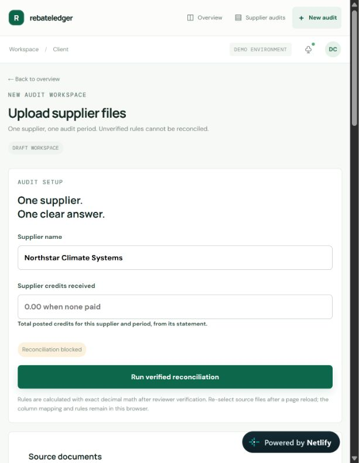
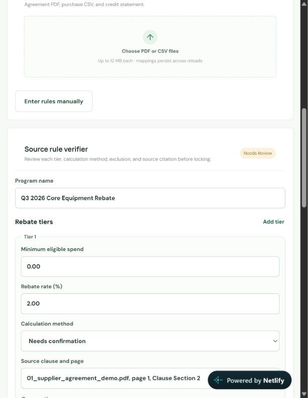
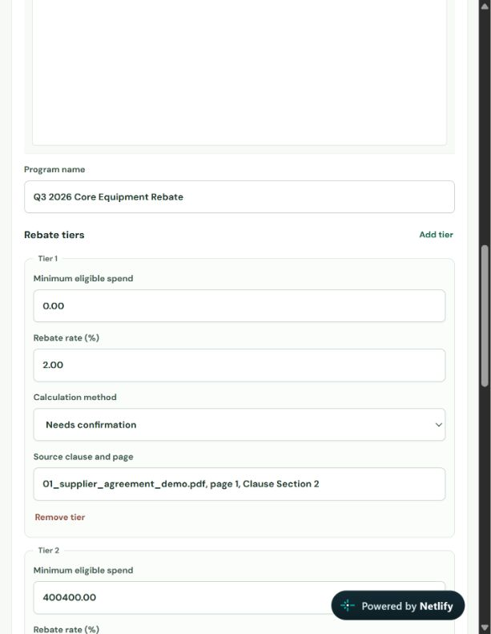
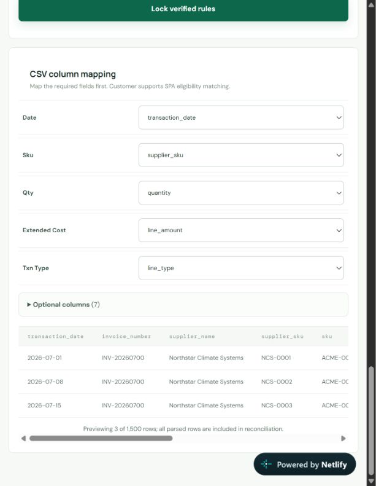

# MarginsRecovery PDF upload and extraction audit

**Date:** 2026-11-16  
**Surface:** Production `/dashboard/upload` at `https://gilded-marigold-d7d053.netlify.app`  
**Goal:** Upload the synthetic supplier agreement and ERP export, review extracted rules, and confirm the review gate survives a reload.

## Flow evidence

### 1. Upload workspace and review gate

The upload workspace loads while authenticated. It explains that unverified rules cannot be reconciled, and the reconciliation action is visibly blocked. The browser exposed the workspace as labeled inputs and controls. The screenshot is a 613 × 790 in-app browser viewport.

### 2. Source upload and rule verification

The PDF/CSV upload target is clear. The successful-extraction view keeps the manual-entry control visible. The verifier marks the contract `Needs Review`; Tier 1 requires confirmation. The form presents exact spend/rate fields and source citations in editable cards.

### 3. Live extraction result

The current-run upload of `01_supplier_agreement_demo.pdf` and the 1,500-row `02_erp_purchase_export_demo.csv` populated the program, two tiers, citations, and CSV preview. Tier 1 remains `Needs confirmation`; Tier 2 is marked retroactive. No DOMMatrix, JSON parse, or PDF service error appeared in the rendered page. The PDF preview iframe occupied a large blank area in this browser capture; the iframe had a blob URL, but its visual PDF rendering was not available here.

### 4. CSV mapping and reload persistence

The required fields mapped to `transaction_date`, `supplier_sku`, `quantity`, `line_amount`, and `line_type`. The preview reports 3 of 1,500 rows and provides a horizontal scrollbar for the remaining columns.

After reloading the page, the tier rules and required CSV mappings remained in the browser. Source files had to be selected again, as the page explains. At this viewport width, the transaction preview uses horizontal scrolling rather than fitting all columns at once.

## Audit result

**Overall:** The live upload and candidate-rule flow worked in this run, and the accounting verification gate stayed closed for an unverified rule. Focused tests pass after fixing an extractor ambiguity leak.

**Strengths**

- Upload controls, required fields, rule fields, and mapping controls are labeled and discoverable in the rendered DOM.
- The live demo PDF and 1,500-row CSV produced populated rule fields and a usable mapping preview.
- Tier 1 ambiguity remains visible as `Needs confirmation`; reconciliation remains blocked.
- Contract rules and required mappings survived a reload; selected source files did not.

**UX and accessibility risks**

- The PDF preview is a large blank rectangle in this in-app browser state (`03-extracted-rules.png`). Confirm whether supported end-user browsers render it; otherwise replace it with a clear preview or download link.
- Manual entry is still prominent after successful extraction (`02-upload-controls.png`). Consider collapsing it until extraction fails or a reviewer expands it.
- The narrow capture shows a horizontally scrollable multi-column preview (`05-after-reload.png`); verify this at desktop width and a true 375px viewport before claiming responsive coverage.
- Small helper text appears low contrast in the captures. Contrast ratios, keyboard-only operation, focus order, screen-reader names, and zoom behavior were not measured, so this is not a WCAG conformance result.

## Verification and limits

- Live UI: synthetic PDF and CSV uploaded; extracted fields appeared; no visible extraction error banner or DOMMatrix/JSON parse error. After reload, the rendered DOM had no extraction error text and the browser console error list was empty.
- Persistence: rules and required mappings remained after reload; source file selections cleared as instructed by the page.
- Automated: `npm test` passed, including the benchmark, export fidelity, and new extractor provider regression; `npm run typecheck` passed; targeted ESLint passed for the modified extractor and new test.
- The new regression proves a retroactive phrase scoped to a higher tier cannot resolve an ambiguous lower tier. Claude API behavior is mocked in the automated test; the live run confirms the browser upload path but does not independently expose the provider identifier or raw HTTP response headers.
- No reconciliation was submitted, no durable audit was created, and no deployment or source commit was made in this task.
- The screenshots are fresh captures from this audit. Browser viewport was 613 × 790; no 375px or desktop-width capture was made. Contrast, keyboard, assistive technology, and PDF rendering outside this in-app browser remain unverified.
